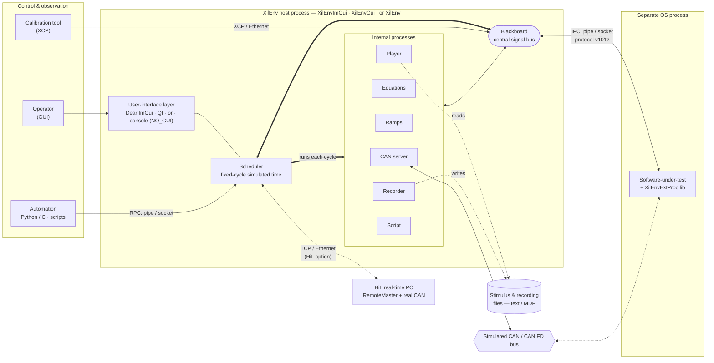
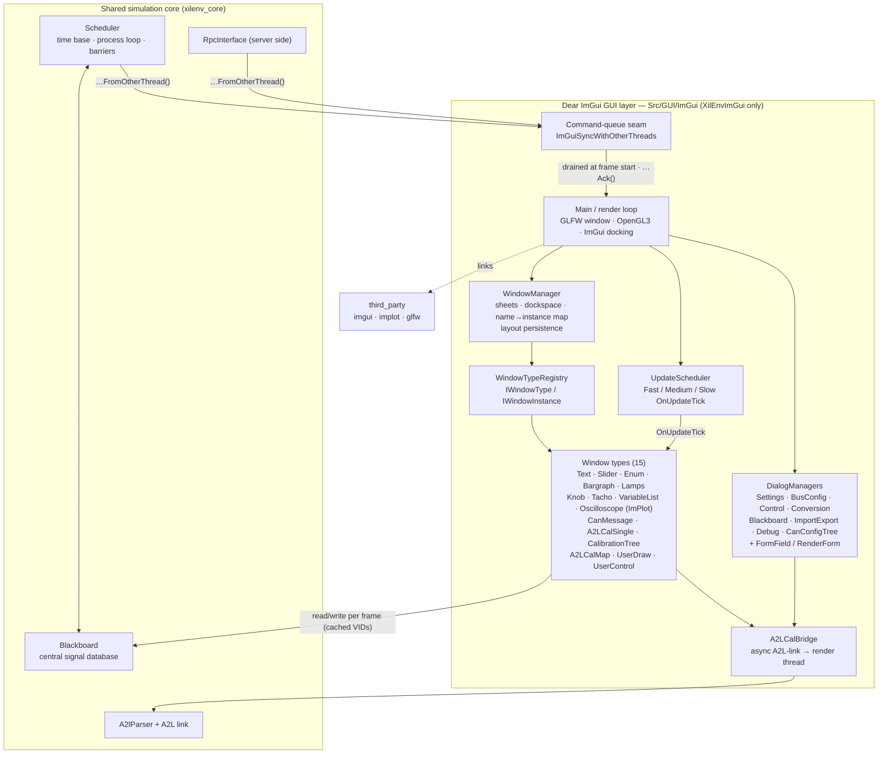
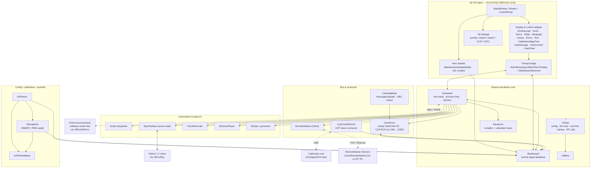
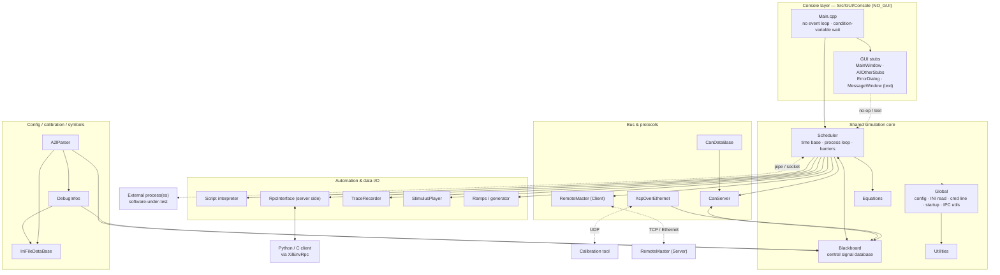

# OpenXilEnv Architecture

This document gives an architectural overview of the OpenXilEnv executables and
of the software components that make up the repository. There are **three GUI
front-ends** over one shared simulation core:

- **XilEnvImGui** &mdash; the **primary** graphical front-end (Dear ImGui / GLFW).
- **XilEnvGui** &mdash; the legacy Qt Widgets front-end, retained in parallel for
  verification.
- **XilEnv** &mdash; the headless command-line variant (for automation / CI).

All three link the **same** `xilenv_core` static library; only the user-interface
layer differs. This document is the entry point for developers who want to
understand how the many modules under [`Src/`](../Src) fit together.

> **Front-end migration:** the GUI is being migrated from Qt Widgets to Dear ImGui.
> `XilEnvImGui` is a full port (all window types + dialogs, config-interchangeable
> with the Qt build) and is now the primary GUI; `XilEnvGui` is kept for side-by-side
> verification until it is retired. See [The GUI/core seam](#the-guicore-seam).

For the end-user view of the SiL/HiL system, see the [Readme](../Readme.md).

## Table of contents

- [Big picture](#big-picture)
- [Build outputs](#build-outputs)
- [The GUI/core seam](#the-guicore-seam)
- [Component diagram: XilEnvImGui](#component-diagram-xilenvimgui)
- [Component diagram: XilEnvGui](#component-diagram-xilenvgui)
- [Component diagram: XilEnv (CLI)](#component-diagram-xilenv-cli)
- [The three front-ends compared](#the-three-front-ends-compared)
- [Shared simulation core](#shared-simulation-core)
- [Configuration, calibration and symbols](#configuration-calibration-and-symbols)
- [Bus, protocol and remote components](#bus-protocol-and-remote-components)
- [Automation and data I/O](#automation-and-data-io)
- [The external process interface](#the-external-process-interface)
- [Other components in the repository](#other-components-in-the-repository)

## Big picture

OpenXilEnv is a **S**oftware/**H**ardware **I**n **t**he **L**oop environment.
Its job is to run a piece of embedded software (or a model) in a deterministic,
time-simulated environment, to feed it stimulus, to observe and calibrate its
variables, and to simulate the buses (CAN / CAN FD) it talks to.

Architecturally the product is built around one central idea: a **Blackboard**
(an in-memory signal database) sits at the centre, and a **Scheduler** advances
simulated time in fixed cycles, running a set of *processes* against that
Blackboard every cycle. Processes are either:

- **internal** &mdash; compiled into the executable (CAN server, script
  interpreter, recorder, player, ramp generator, equation calculator, RPC
  control, &hellip;), or
- **external** &mdash; the software-under-test, running in its **own** OS
  process for memory protection and communicating with XilEnv over an IPC
  channel (named pipe / Unix domain socket / TCP socket).

All front-ends are built on top of the **same** `xilenv_core` static library
(everything under `Src/` except `Src/GUI/*`). The only substantial difference is
the user-interface layer and its implementation of the GUI/core seam:
`XilEnvImGui` links the Dear ImGui GUI (`Src/GUI/ImGui`, GLFW + OpenGL3),
`XilEnvGui` links the Qt GUI (`Src/GUI/Qt`), and `XilEnv` links a set of headless
console stubs (`Src/GUI/Console`) and is compiled with `NO_GUI`. Four small
"border" files (`ThrowError.c`, `A2LLink.c`, `StartupInit.c`, `ParseCommandLine.c`)
are compiled per front-end because they differ under `NO_GUI`.

The following block diagram shows this concept at a glance: the **Scheduler**
drives simulated time, the **Blackboard** is the central signal bus that
everything reads from and writes to, and the software-under-test runs in a
separate OS process connected over an IPC channel.

## Build outputs

The top-level [`CMakeLists.txt`](../CMakeLists.txt) produces the following
artifacts (64-bit host unless noted):

| Artifact | Type | Purpose |
| --- | --- | --- |
| **xilenv_core** | static lib | Shared simulation core (everything under `Src/` except `Src/GUI/*`); linked by every front-end and the unit tests |
| **XilEnvImGui** | executable | **Primary** Dear ImGui / GLFW graphical SiL/HiL environment |
| **XilEnvGui** | executable | Legacy Qt-based graphical environment (retained for verification) |
| **XilEnv** | executable | Headless (CLI) environment for automation (`NO_GUI`) |
| **xilenv_core_tests** | executable | GoogleTest / CTest unit tests for the C core |
| **XilEnvRpc**`.dll`/`.so` | shared lib | Remote-control API for external clients (Python/C) |
| **XilEnvExtProc64/32**`.dll`/`.so` | shared lib | Interface loaded by the software-under-test |
| **LinuxRemoteMasterCore**`.so` | shared lib | Real-time HiL core (Linux + RT-Preempt) |
| **LinuxRemoteMaster.Out** | executable | Standalone HiL real-time master |
| **RemoteStartServer** | executable | Launches processes remotely on the HiL PC (Linux) |

`XilEnvImGui`, `XilEnvGui` and `XilEnv` are three thin front-ends over the same
`xilenv_core` library; the core is compiled **once** and reused. The examples
under [`Samples/`](../Samples) and the tools under [`Tools/`](../Tools) are also
built when enabled.

## The GUI/core seam

The boundary between the simulation core and any front-end is a **C ABI**, not a
C++ interface: the header
[`Src/GUI/Qt/MainWinowSyncWithOtherThreads.h`](../Src/GUI/Qt/MainWinowSyncWithOtherThreads.h)
declares ~79 `…FromOtherThread()` functions (open/close windows, sheet
management, progress bars, script dialogs, scheduler state). The **core calls
these**; the front-end processes them on its own UI thread and replies with a
matching `…Ack()`. Blocking calls suspend the calling (scheduler/RPC) thread on a
per-thread wait slot until the UI thread acknowledges.

There are **three independent implementations of the same header**, one per
front-end — the core never changes:

| Front-end | Implementation | Mechanism |
| --- | --- | --- |
| **XilEnvGui** (Qt) | `Src/GUI/Qt/…` | Posts a Qt signal, blocks on a `QWaitCondition`; the GUI thread runs the slot and wakes the caller. |
| **XilEnvImGui** (ImGui) | `Src/GUI/ImGui/ImGuiSyncWithOtherThreads.cpp` | Pushes a tagged command struct onto a thread-safe queue; the render thread drains it at frame start and calls `…Ack()`. Same blocking/wake semantics. |
| **XilEnv** (console) | `Src/GUI/Console/…` (`NO_GUI`) | No-op stubs that acknowledge immediately. |

Because the seam is identical for all three, the core is oblivious to which GUI
(if any) is attached. This is what makes the Qt→ImGui migration a drop-in
replacement of one library rather than a change to the simulation engine.

## Component diagram: XilEnvImGui

`XilEnvImGui` is the **primary** interactive front-end
([`Src/GUI/ImGui`](../Src/GUI/ImGui)). It is an *immediate-mode* GUI built on
**Dear ImGui** (docking branch) with a **GLFW + OpenGL3** backend and **ImPlot**
for graphs. Unlike the Qt build there is no retained widget tree and no
signal/slot data path: every visible window reads its signals **directly from the
Blackboard once per frame** (via cached VIDs), and a lightweight
`UpdateScheduler` reproduces the old Fast/Medium/Slow timer cadence by calling
each window's `OnUpdateTick()` at the right rate.

The GUI runs on the main (render) thread; the scheduler and RPC server run on
their own threads and reach the GUI only through the command-queue
implementation of the sync ABI (see [The GUI/core seam](#the-guicore-seam)).

The framework layer under [`Src/GUI/ImGui/Framework`](../Src/GUI/ImGui/Framework)
is a small set of singletons: the **WindowManager** owns the docked *sheets* /
dockspace, the name→instance map (preserving the `OpenWindowByName` contract) and
layout persistence; the **DialogManager** family renders the ~80 modal/non-modal
dialogs as data-driven forms (`FormField` / `RenderForm`); and the
**A2LCalBridge** marshals asynchronous A2L-link callbacks onto the render thread.
Window types implement `IWindowType` (metadata + factory) and `IWindowInstance`
(`RenderContent` / `OnUpdateTick` / config I/O / drop handling) and are registered
in the `WindowTypeRegistry`.

*Caption: XilEnvImGui component view. The GUI reads the Blackboard directly each
frame (no observer), and the core reaches the GUI only through the command-queue
seam — the exact same ABI the Qt build implements with signals/slots.*

## Component diagram: XilEnvGui

`XilEnvGui` is the legacy Qt front-end, retained in parallel for verification.
The Qt GUI runs its own event loop on the main thread; the scheduler and the RPC
server run on separate threads. All cross-thread requests into the GUI are
marshalled through a blocking signal/acknowledge bridge
(`MainWinowSyncWithOtherThreads`), and Blackboard value changes are pushed to
widgets through the `BlackboardObserver`.

## Component diagram: XilEnv (CLI)

`XilEnv` is the same core with the Qt layer replaced by console stubs and
`NO_GUI` defined. There is no event loop: the main thread simply blocks on a
condition variable until `terminate_main_loop()` is called (typically by a
script finishing or an RPC client requesting shutdown). It is meant to be
driven entirely by the **script interpreter** and/or the **RPC API**, which
makes it the tool of choice for CI and automated testing.

## The three front-ends compared

| Aspect | **XilEnvImGui** | **XilEnvGui** | **XilEnv** |
| --- | --- | --- | --- |
| Status | **Primary** GUI | Legacy (kept for verification) | Headless variant |
| UI layer | `Src/GUI/ImGui` (Dear ImGui, GLFW + OpenGL3, ImPlot) | `Src/GUI/Qt` (Qt Widgets, optional Qt Svg) | `Src/GUI/Console` (headless stubs) |
| Compile flag | &mdash; | &mdash; | `NO_GUI` |
| Sync-ABI impl | Command queue (`ImGuiSyncWithOtherThreads`) | Qt signal/slot + `QWaitCondition` | No-op stubs |
| Live-data path | Direct Blackboard read per frame (immediate mode) | `BlackboardObserver` → widget push | &mdash; |
| Main loop | GLFW render loop (`glfwPollEvents` + draw) | Qt event loop (`QApplication::exec`) | Blocks on a condition variable until termination |
| Entry point | `Src/GUI/ImGui/Main.cpp` | `Src/GUI/Qt/Main.cpp` | `Src/GUI/Console/Main.cpp` |
| Typical use | Interactive operation, calibration, visualization | Side-by-side verification against the ImGui build | Automation, CI, unattended test runs |
| Simulation core | **identical** (`xilenv_core`) | **identical** (`xilenv_core`) | **identical** (`xilenv_core`) |

All three start the core the same way: `StartupInit()` boots the config database,
Blackboard, A2L link thread and the (initially stopped) schedulers;
`SchedulersStartingShot()` releases the scheduler threads; and
`StartRemoteProcedureCallThread()` starts the RPC server. Because every front-end
exposes the *same* C entry points (real GUI, or no-ops / text output), the entire
core links and runs unchanged in all three.

## Shared simulation core

These modules form the runtime that both executables share.

- **Blackboard** ([`Src/Blackboard`](../Src/Blackboard)) &ndash; the central
  in-memory signal database. Every measurable/adjustable value ("bbvari") has a
  unique id, a data type, a name, unit, min/max and a raw&harr;physical
  conversion. It also hosts the **equation engine** (`EquationParser`,
  `ExecutionStack`, `EquationList`) that compiles formula strings into a small
  bytecode used by conversions, triggers and generators. Almost every other
  module depends on it.

- **Scheduler** ([`Src/Scheduler`](../Src/Scheduler)) &ndash; the simulation
  engine. It owns the nanosecond time base and, each cycle, runs the linked list
  of task control blocks (`tcb.h`) for both internal and external processes.
  `ScBbCopyLists` builds per-process snapshots so every process gets a coherent
  read set at the start of a cycle and its writes are committed at the end.
  It also implements the **server side** of the external-process channel
  (`PipeMessages` / `SocketMessages` / `UnixDomainSocketMessages`, wire protocol
  version `1012`) and multicore synchronization barriers (`SchedBarrier`).

- **Global** ([`Src/Global`](../Src/Global)) &ndash; the foundation layer:
  fundamental types, the runtime configuration singleton (`MainValues`),
  command-line parsing, INI reading, startup sequencing, error reporting,
  tracked memory management, FIFO/message IPC and OS abstraction (`Platform`).

- **Utilities** ([`Src/Utilities`](../Src/Utilities)) &ndash; small,
  dependency-free helpers (bounded string operations, safe formatting,
  configurable name prefixes, NaN helpers) used throughout the code base.

- **Equations** ([`Src/Equations`](../Src/Equations)) &ndash; a thin scheduler
  wrapper that runs signal-calculation formulas cyclically: an *equation
  compiler* task and an *equation calculator* task, both driving the
  Blackboard-hosted equation engine. A split variant exists for the RemoteMaster
  (HiL) configuration.

## Configuration, calibration and symbols

- **IniFileDataBase** ([`Src/IniFileDataBase`](../Src/IniFileDataBase)) &ndash;
  an in-memory, section/entry configuration database with typed accessors and
  thread-safe access, exposed through a stable C façade (`IniDataBase.h`, ~40
  functions used by 70+ callers). It is the persistence layer for the whole
  application configuration and a leaf dependency of the calibration/symbol
  modules. The on-disk format is now **TOML** (via toml++) behind the unchanged
  façade — a section becomes a TOML table and an entry a key; binary blobs
  (`…ReadByteImage`/`…WriteByteImage`) are hex-encoded. Legacy `.ini` files are
  still read through a fallback parser, and an `ini`→TOML converter tool is
  provided. Configuration is **split into two files**:
  - `<name>.toml` &ndash; the **engine config** (models, processes, scheduler,
    bus setup; the `s_main_ini_val` values in `Src/Global/MainValues.h`), shared
    by *all* executables.
  - `<name>.layout.toml` &ndash; the **GUI layout** (sheets, window positions,
    docking blob), written only by the graphical front-ends.

  The two are routed through the same open descriptor by section (`RouteDescriptorBySection`);
  `StartupInit()` derives the layout path from the engine path. `XilEnv` (headless)
  only ever touches the engine file.

- **DebugInfos** ([`Src/DebugInfos`](../Src/DebugInfos)) &ndash; reads debug
  information from the software-under-test (**DWARF** for GCC/ELF, **PDB** for
  Visual Studio) and builds a symbol/type database mapping variable names to
  memory addresses and full C/C++ type information. It then reads/writes live
  values in the external process by address.

- **A2lParser** ([`Src/A2lParser`](../Src/A2lParser)) &ndash; parses ASAM
  MCD-2 MC (A2L) calibration files, provides query/access to
  MEASUREMENTs/CHARACTERISTICs, converts raw&harr;physical via COMPU_METHODs
  (using the equation engine for formula-based conversions), binds labels to a
  running process (via DebugInfos), and exports to XCP/CANape formats.

Dependency direction: `A2lParser` &rarr; `DebugInfos` &rarr; `IniFileDataBase`,
with both `A2lParser` and `DebugInfos` reading/writing the `Blackboard`.

## Bus, protocol and remote components

- **CanDataBase** ([`Src/CanDataBase`](../Src/CanDataBase)) &ndash; defines CAN
  variants/messages/signals (bit layout, scaling, byte order, multiplexing),
  imports `.dbc` files, and compiles everything into the packed
  `NEW_CAN_SERVER_CONFIG` runtime structure the CAN server executes.

- **CanServer** ([`Src/CanServer`](../Src/CanServer)) &ndash; the runtime engine
  that simulates CAN/CAN FD traffic each cycle: signal&harr;Blackboard
  encode/decode, cyclic/event transmission, residual-bus simulation, J1939
  multi-packet transport, bus-error injection, and **CCP/XCP masters over the
  simulated CAN bus**. Its bus backend is a function-pointer table, selected at
  build time between the internal virtual driver, a gateway driver, or Linux
  **SocketCAN** (on the HiL real-time side).

- **XcpOverEthernet** ([`Src/XcpOverEthernet`](../Src/XcpOverEthernet)) &ndash;
  implements the **XCP protocol over Ethernet (UDP)** so an external calibration
  system can measure (DAQ) and calibrate variables of a process running inside
  XilEnv, treating it as an XCP slave. (This is distinct from the XCP *master*
  over CAN that lives in `CanServer`.)

- **RemoteMaster** ([`Src/RemoteMaster`](../Src/RemoteMaster)) &ndash; the HiL
  client/server split. The **Client** (linked into XilEnv) provides RPC proxies
  that forward Blackboard/scheduler/CAN/model/file/memory operations over
  TCP/Ethernet to the **Server** (`LinuxRemoteMasterCore`, running on a
  real-time Linux PC). On the server, a real-time scheduler runs the model and
  the CAN server against real CAN hardware via SocketCAN drivers. This is how
  the same simulation code runs either against a virtual bus (SiL, in-host) or
  against real hardware (HiL, on the RT box).

## Automation and data I/O

Every executable can be driven and instrumented without a user present:

- **Script** ([`Src/Script`](../Src/Script)) &ndash; the built-in `.sct`
  automation interpreter (parser + VM, ~150 commands, HTML report output). Runs
  as an internal scheduler process and can start/stop processes, read/write the
  Blackboard, and control the recorder, player, ramps and CAN.

- **RpcInterface** ([`Src/RpcInterface`](../Src/RpcInterface)) &ndash; the
  external control plane. `XilEnvRpc.dll/.so` is the client library (wrapped by
  the [Python API](PYTHON_API_REFERENCE.md)); the in-process
  `RpcSocketServer` accepts connections over **named pipe / Unix domain socket /
  TCP (default port 1810)** and dispatches ~hundreds of `XilEnv_*` calls to
  handlers that drive the scheduler, Blackboard, GUI, CAN/CCP/XCP and the other
  automation processes.

- **TraceRecorder** ([`Src/TraceRecorder`](../Src/TraceRecorder)) &ndash;
  samples selected Blackboard variables each cycle (with trigger and look-back
  ring buffer) and writes them to text, **MDF3** or **MDF4** files.

- **StimulusPlayer** ([`Src/StimulusPlayer`](../Src/StimulusPlayer)) &ndash; the
  inverse of the recorder: reads recorded traces (text / MDF3 / MDF4) and
  replays them into the Blackboard cycle by cycle.

- **Ramps** ([`Src/Ramps`](../Src/Ramps)) &ndash; a signal generator that
  computes time-based ramp/waveform sequences (compiler + calculator tasks) and
  drives them onto Blackboard variables.

## The external process interface

The software-under-test does **not** link the XilEnv core. Instead it loads the
**XilEnvExtProc** shared library ([`Src/ExternalProcess`](../Src/ExternalProcess),
built as `XilEnvExtProc64/32`), which exposes the same Blackboard read/write and
CAN API but transparently marshals every call across an IPC channel to the
scheduler. `XilEnvExtProcMain.c` handles loading it automatically; interface
functions are declared in `XilEnvRtProc.h`.

The channel is a versioned request/response protocol (version `1012`) with four
selectable transports:

| Transport | Server side (Scheduler) | Client side (ExternalProcess) | Typical use |
| --- | --- | --- | --- |
| Named pipe | `PipeMessages.c` | `ExtpPipeMessages.c` | Windows, same machine |
| Unix domain socket | `UnixDomainSocketMessages.c` | `ExtpUnixDomainSocketMessages.c` | Linux, same machine |
| TCP socket | `SocketMessages.c` | `ExtpSocketMessages.c` | Cross-machine / remote |
| QEMU SiL connector | (RemoteMaster path) | QEMU init | Virtualized targets |

Flow: the external process **logs in** (sending its name, PID, process count,
priority, base addresses); during a **reference** phase its callback registers
the variables it needs (`add_bbvari*`), which populates the copy lists on both
sides; then every cycle the scheduler ships the process's read snapshot, invokes
its `cyclic` callback, and reads back its write snapshot &mdash; keeping the
model deterministic and time-synchronized. Because it runs as a separate OS
process, a crash in the software-under-test cannot corrupt XilEnv's memory.

An example external process is provided under
[`Samples/ExternalProcesses/ExtProc_Simple`](../Samples/ExternalProcesses/ExtProc_Simple);
see [Setting up an External Process](EXTERNAL_PROCESS_SETUP.md).

## Other components in the repository

- **FMU tools** &ndash; helper executables that let XilEnv load Functional
  Mock-up Units as external processes: `ExtProc_FMU2Extract/Loader32/Loader64`
  (FMI 2.0) and `ExtProc_FMU3Extract/Loader32/Loader64` (partial FMI 3.0),
  built when `BUILD_WITH_FMU2_SUPPORT` / `BUILD_WITH_FMU3_SUPPORT` are enabled.

- **RemoteStartServer** ([`Tools/RemoteStartServer`](../Tools/RemoteStartServer))
  &ndash; a small Linux service that must run on the HiL PC so that XilEnv can
  launch the real-time master / model remotely over the network.

- **Samples** ([`Samples/`](../Samples)) &ndash; example external processes and
  models, including optional Esmini/OpenSCENARIO examples.

- **Tests** &ndash; two complementary layers:
  - **C-core unit tests** ([`test/unit`](../test/unit)) &ndash; GoogleTest /
    CTest (`xilenv_core_tests`) linked against `xilenv_core`; characterization
    and contract tests for the Blackboard, the ini/TOML façade, and the
    equation / A2L / CAN / S19 / ramp helpers. Run with `ctest` from the build
    directory.
  - **Functional tests** ([`test/functional`](../test/functional)) &ndash;
    pytest-based tests that exercise a real OpenXilEnv installation through the
    Python API. See the [Readme](../Readme.md#test) for how to run them.
